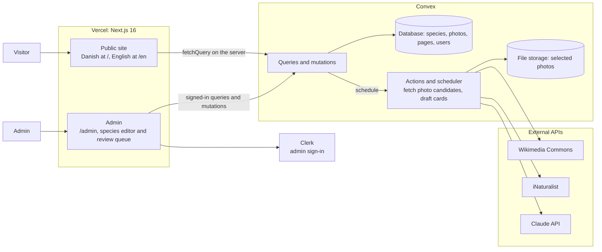

# Architecture spec

Status: agreed, 2026-10-26. Replaces the Payload and Supabase architecture (see milestone C in the roadmap).

## 1. Overview

One Next.js app on Vercel for the public site and the admin, and one Convex project for everything behind them: the database, file storage for photos, server functions, and the background jobs. Only Convex actions talk to outside APIs, and only selected photos are copied into Convex file storage.

## 2. Stack

| Area            | Choice                                                                                                                                                                                               |
| --------------- | ---------------------------------------------------------------------------------------------------------------------------------------------------------------------------------------------------- |
| Framework       | Next.js 16 (App Router), TypeScript, pnpm                                                                                                                                                            |
| Backend         | Convex: database, file storage, queries, mutations, actions and the scheduler. Functions live in `convex/` and share pure logic with the app via `src/domain/`.                                      |
| Admin sign-in   | Clerk (Google sign-in), passed to Convex as a JWT (`convex/auth.config.ts`). Roles live in the Convex `users` table. Until the Clerk instance exists, a placeholder login guards the admin (see §6). |
| Styling         | Tailwind CSS 4, tokens in `src/styles/tokens.css`, visual system in `DESIGN.md`                                                                                                                      |
| Lint and format | Biome                                                                                                                                                                                                |
| Translations    | next-intl for UI strings and routing. Content fields are stored per locale (`{ da, en? }`). Danish is the default and required.                                                                      |
| Content format  | Card and page text is Markdown (paragraphs, lists, links, emphasis), rendered without raw HTML.                                                                                                      |
| Images          | Selected photos in Convex file storage, served through `ctx.storage.getUrl` and Next.js image optimization. Candidates keep only their remote URL.                                                   |
| Hosting         | Vercel for Next.js, with a preview deploy per PR. Convex production deployment for the backend.                                                                                                      |
| Background jobs | Convex actions started through `ctx.scheduler`. A job row records status, so the admin sees progress. See §5.                                                                                        |
| AI              | Claude API with web search and a strict submit tool. The key lives in Convex environment variables, with a spend limit.                                                                              |
| Analytics       | Vercel Web Analytics (cookie-free, no consent banner)                                                                                                                                                |
| Tests           | Vitest for pure logic, `convex-test` for Convex functions, Playwright for user flows                                                                                                                 |
| CI              | GitHub Actions on every PR: lint, type check, unit and Convex tests, Playwright against the build                                                                                                    |

## 3. Data model (Convex, `convex/schema.ts`)

Localized text is an object `{ da: string, en?: string }`. Markdown fields are optional until a card is published.

### `species`

| Field                                             | Type                                                           | Localized   |
| ------------------------------------------------- | -------------------------------------------------------------- | ----------- |
| `slug`                                            | string, unique (index `by_slug`)                               | No          |
| `name`                                            | string                                                         | Yes         |
| `latinName`                                       | string                                                         | No          |
| `localNames`                                      | object: `da`, `sv`, `nb`, `de`, `nl`, `en` (arrays of text)    | No          |
| `isWarning`, `warningReason`                      | boolean, string                                                | Reason: yes |
| `greenCarving`                                    | easy, medium, hard                                             | No          |
| `dryHardness`, `jankaN`                           | soft, medium, hard; number                                     | No          |
| `grainTexture`, `colourSmell`, `riving`, `drying` | Markdown                                                       | Yes         |
| `goodForTags`, `goodFor`                          | array of uses; Markdown                                        | Text: yes   |
| `foodSafety`                                      | Markdown                                                       | Yes         |
| `foodSafetyChecked`, `foodSafetyCheckedAt`        | boolean, timestamp                                             | No          |
| `idFeatures`                                      | object: leaf, bark, twig, shape, cutWood (Markdown each)       | Yes         |
| `lookAlikes`                                      | array of `species` ids                                         | No          |
| `filterTraits`                                    | object of arrays (see product spec 6.2)                        | No          |
| `sources`                                         | array: title, url, field                                       | No          |
| `status`                                          | aiDraft, needsChanges, approved, published (index `by_status`) | No          |
| `launchWave`                                      | launch, 2                                                      | No          |
| `reviewNotes`                                     | string                                                         | No          |

### `speciesRevisions`

A snapshot of a species' card fields before every draft or edit: `speciesId`, `reason` (draft or edit), `snapshot` (JSON). Replaces Payload's version history.

### `photos`

| Field                              | Type                                                                                     |
| ---------------------------------- | ---------------------------------------------------------------------------------------- |
| `speciesId`                        | `species` id                                                                             |
| `slot`                             | wholeTree, leaf, bark, winterTwig, cutWood (on candidates, a suggestion from the source) |
| `status`                           | candidate, selected, rejected                                                            |
| `source`                           | commons, inaturalist, upload (later: userSubmission)                                     |
| `sourceUrl`, `remoteUrl`           | string                                                                                   |
| `storageId`                        | Convex file id, set once a selected photo has been copied into storage                   |
| `author`, `license`, `attribution` | string; CC0, CC-BY or CC-BY-SA (versioned or not); string                                |
| `alt`                              | string, localized                                                                        |
| `fetchedAt`                        | timestamp                                                                                |

Indexes: `by_species_and_status`, `by_species_and_source_url` (de-duplication), `by_status` (review queue).

### `pages`

`slug` (`about`, `whereToGetWood`), `title` and `content` (Markdown), both localized.

### `users`

Admin accounts only; no public sign-up. `tokenIdentifier` (from the Clerk JWT, index `by_token`), `email`, `name`, `role` (`admin`). A signed-in user without a row, or without the `admin` role, sees nothing in the admin. The first admin row is created with an internal mutation from the CLI.

### `jobs`

`kind` (fetchPhotos, draftCard, storePhoto), `speciesId`, `status` (queued, running, done, failed), `error`, timestamps. Index `by_species`.

## 4. Business rules

- **Publish rules** (product spec 7.3) are pure functions in `src/domain/publishRules.ts`, called by every mutation that can publish. Unit tested, plus a Convex test that a publish attempt with a broken rule throws.
- **One selected photo per slot:** selecting a photo demotes any previously selected photo in that slot back to candidate, in the same mutation.
- **License filter:** a pure function mapping each source's license string to an allowed license or a rejection. Unit tested with real samples from both APIs.
- **Visitor access:** public queries return only published species, their selected photos and the pages. Everything else requires the `admin` role, checked server-side in every admin function.

## 5. Jobs

| Job           | Started by            | Steps                                                                                                                                                                                                | Output                                          |
| ------------- | --------------------- | ---------------------------------------------------------------------------------------------------------------------------------------------------------------------------------------------------- | ----------------------------------------------- |
| `fetchPhotos` | Admin button          | Query Commons (species category plus bark and leaf subcategories) and iNaturalist (research grade, license filter in the query). Normalize metadata, filter licenses, skip duplicates by source URL. | Up to about 20 `photos` with status `candidate` |
| `storePhoto`  | Selecting a candidate | Download the remote file (known image hosts over https only) into Convex file storage and set `storageId`.                                                                                           | A stored file for the selected photo            |
| `draftCard`   | Admin button          | Three sections (carving, safety, identification), one Claude call each with web search and a strict submit tool. Write in Danish, with sources per field. A revision is saved first.                 | Card fields updated, status `aiDraft`           |
- A mutation inserts the job row and schedules the action with `ctx.scheduler.runAfter(0, ...)`; the action reports progress through internal mutations. Each step is stored before the next starts, so a failed run can be retried from the admin.
- Convex actions run for up to 10 minutes, so three web-searching Claude calls fit in one run. This removes the Vercel function time limit risk from milestone 2.
- API etiquette: a descriptive User-Agent for Wikimedia, about 1 request per second for iNaturalist, and a spend limit on the Claude API key.

## 6. Admin sign-in

- Clerk handles sign-in (Google). The Next.js app wraps the admin in `ClerkProvider` and `ConvexProviderWithClerk`; Convex verifies the token through `convex/auth.config.ts` (issuer from `CLERK_JWT_ISSUER_DOMAIN`).
- Every admin query and mutation calls one helper that looks up the caller's `users` row by `tokenIdentifier` and requires `role: "admin"`. No function takes an identity argument.
- **Interim, until the Clerk instance exists:** a placeholder login on `/admin/login` checks a username and password from environment variables (`admin` / `admin` only in development) and sets an httpOnly session cookie. Admin calls then pass a server-held `ADMIN_SECRET`, which the same Convex helper accepts as an alternative to a Clerk identity. Both the placeholder login and the secret path are removed when Clerk is wired in.

## 7. Routing and i18n

- next-intl with localized pathnames. Danish has no prefix (`/arter`), English is prefixed (`/en/species`).
- English routes are disabled until English content exists (a flag in config).
- The admin lives under `/admin`, outside the locale routing, and is Danish only.

## 8. Testing

| Layer      | Tool                   | Covers                                                                                                                    |
| ---------- | ---------------------- | ------------------------------------------------------------------------------------------------------------------------- |
| Unit       | Vitest                 | License filter, attribution parsing, publish rules, filter key matching, the filter key acceptance check on the seed data |
| Convex     | Vitest + `convex-test` | Visitor access, publish enforcement, one photo per slot, job bookkeeping, seed idempotency, admin role checks             |
| End to end | Playwright             | Public pages against a Convex backend seeded with fixtures; one species from AI draft to Published via the admin          |
| CI         | GitHub Actions         | Lint (Biome), type check, unit and Convex tests and Playwright on every PR                                                |

## 9. Risks

| Risk                                                               | Mitigation                                                                                            |
| ------------------------------------------------------------------ | ----------------------------------------------------------------------------------------------------- |
| End-to-end tests need a Convex backend in CI                       | Run a local Convex backend in CI, or a preview deployment with a deploy key. Decided in milestone C2. |
| No ready-made CMS UI: the admin is ours to build and maintain      | Keep it small: a species editor, the review queue and the two page editors. No generic content model. |
| Too few usable winter-twig photos online                           | Allow the admin's own uploads for that slot. Launch species are common trees.                         |
| The filter key is too coarse for similar species (birches, maples) | The acceptance check flags it before launch. Each card links to its look-alikes.                      |

## Sources

- [Convex: Next.js server rendering](https://docs.convex.dev/client/nextjs/app-router/server-rendering)
- [Convex: Clerk](https://docs.convex.dev/auth/clerk)
- [Convex: file storage](https://docs.convex.dev/file-storage)
- [inat2commons.js: iNaturalist license filter example](https://github.com/kaldari/iNaturalist2Commons/blob/main/inat2commons.js)
