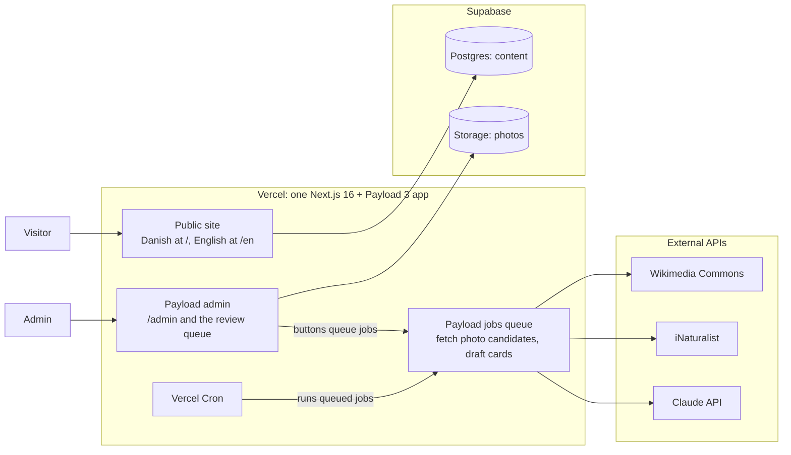

# Architecture spec

Status: agreed for v1, 2026-10-26.

## 1. Overview

One Next.js app with Payload CMS inside it, deployed on Vercel. The public site and the admin are the same deploy. Only the background jobs talk to outside APIs, and only selected photos are copied into Supabase Storage.

## 2. Stack

| Area            | Choice                                                                                                                                                         |
| --------------- | -------------------------------------------------------------------------------------------------------------------------------------------------------------- |
| Framework       | Next.js 16 (App Router) + Payload 3, TypeScript, pnpm                                                                                                          |
| Styling         | Tailwind CSS 4                                                                                                                                                 |
| Lint and format | Biome                                                                                                                                                          |
| Translations    | next-intl for UI strings and routing. Payload field localization for content. Danish is the default.                                                           |
| Database        | Supabase Postgres via `@payloadcms/db-postgres`. Schema changes only through committed migrations, applied on production start (`prodMigrations`).             |
| Images          | Supabase Storage via Payload's S3 storage adapter. Next.js image optimization on the public site.                                                              |
| Hosting         | Vercel, with a preview deploy per PR                                                                                                                           |
| Background jobs | Payload jobs queue. An admin action queues a job and runs it immediately after the response (`after()`); a daily Vercel Cron call sweeps up leftovers. See §5. |
| AI              | Claude API (model picked when building), web search tool, structured output. Spend limit set on the API key.                                                   |
| Analytics       | Vercel Web Analytics (cookie-free, no consent banner)                                                                                                          |
| Unit tests      | Vitest                                                                                                                                                         |
| Browser tests   | Playwright                                                                                                                                                     |
| CI              | GitHub Actions on every PR: lint, type check, unit tests, Playwright against the build                                                                         |

## 3. Data model (Payload)

### `species`

Versions and drafts enabled.

| Field                                             | Type                                                       | Localized   |
| ------------------------------------------------- | ---------------------------------------------------------- | ----------- |
| `slug`                                            | text, unique                                               | No          |
| `latinName`                                       | text                                                       | No          |
| `localNames`                                      | group: `da`, `sv`, `nb`, `de`, `nl`, `en` (arrays of text) | No          |
| `isWarning`, `warningReason`                      | checkbox, text                                             | Reason: yes |
| `greenCarving`                                    | select: easy, medium, hard                                 | No          |
| `dryHardness`, `jankaN`                           | select: soft, medium, hard; number                         | No          |
| `grainTexture`, `colourSmell`, `riving`, `drying` | rich text                                                  | Yes         |
| `goodForTags`, `goodFor`                          | multi-select; rich text                                    | Text: yes   |
| `foodSafety`                                      | rich text                                                  | Yes         |
| `foodSafetyChecked`, `foodSafetyCheckedAt`        | checkbox, date                                             | No          |
| `idFeatures`                                      | group: leaf, bark, twig, shape, cutWood (rich text each)   | Yes         |
| `lookAlikes`                                      | relationship to `species`, many                            | No          |
| `filterTraits`                                    | group of multi-selects (see product spec 6.2)              | No          |
| `sources`                                         | array: title, url, field                                   | No          |
| `status`                                          | select: aiDraft, needsChanges, approved, published         | No          |
| `launchWave`                                      | select: launch, 2                                          | No          |
| `reviewNotes`                                     | textarea                                                   | No          |

### `photos` (upload collection)

| Field                              | Type                                                         |
| ---------------------------------- | ------------------------------------------------------------ |
| `species`                          | relationship to `species`                                    |
| `slot`                             | select: wholeTree, leaf, bark, winterTwig, cutWood           |
| `status`                           | select: candidate, selected, rejected                        |
| `source`                           | select: commons, inaturalist, upload (later: userSubmission) |
| `sourceUrl`, `remoteUrl`           | text                                                         |
| `author`, `license`, `attribution` | text; select (CC0, CC-BY, CC-BY-SA with versions); text      |
| `fetchedAt`                        | date                                                         |

A candidate keeps only `remoteUrl` and metadata. Selecting it downloads the file into the upload collection, stored in Supabase Storage.

### `users`

Auth collection for admins only. No public sign-up. The first admin is created by a seed script.

### Globals

`whereToGetWood` and `about`: localized rich text.

## 4. Business rules

- **Publish rules** (product spec 7.3) live in a `beforeChange` hook on `species` and are pure functions with unit tests.
- **One selected photo per slot:** selecting a photo demotes any previously selected photo in that slot back to candidate.
- **License filter:** a pure function mapping each source's license string to an allowed license or a rejection. Unit tested with real samples from both APIs.

## 5. Jobs

| Job                    | Input      | Steps                                                                                                                                                                                                | Output                                                                        |
| ---------------------- | ---------- | ---------------------------------------------------------------------------------------------------------------------------------------------------------------------------------------------------- | ----------------------------------------------------------------------------- |
| `fetchPhotoCandidates` | species ID | Query Commons (species category plus bark and leaf subcategories) and iNaturalist (research grade, license filter in the query). Normalize metadata, filter licenses, skip duplicates by source URL. | Up to about 20 `photos` with status `candidate`                               |
| `draftCard`            | species ID | Call the Claude API with the web search tool and a structured output schema matching the card fields. Write in Danish, with sources per field.                                                       | Card fields updated, status `aiDraft`. Previous text kept in version history. |

API etiquette: a descriptive User-Agent for Wikimedia, about 1 request per second for iNaturalist, and a spend limit on the Claude API key.

### Runtime model (milestone 2)

- Payload's `jobs.autoRun` is not used: Payload's own config docs say it should not run on serverless platforms like Vercel.
- An admin button queues the job (`payload.jobs.queue`) and runs it right away in the same route handler, after the response has been sent (`after(() => payload.jobs.runByID(...))`). The route sets an explicit `maxDuration`.
- A daily Vercel Cron call to `/api/payload-jobs/run`, authorized with `CRON_SECRET`, sweeps up failed or cut-off jobs.
- Jobs are split into short, idempotent tasks so an interrupted run resumes: `fetchPhotoCandidates` runs one task per source, `draftCard` one Claude call per group of card sections, each stored before the next starts.
- Open: Vercel's exact duration and cron limits for this plan are unverified, and a Claude call with web search has not been timed yet (needs an API key, milestone 6).

## 6. Routing and i18n

- next-intl with localized pathnames. Danish has no prefix (`/arter`), English is prefixed (`/en/species`).
- English routes are disabled until English content exists (a flag in config).
- Payload localization: `da` (default, required) and `en` (optional).

## 7. Testing

| Layer      | Tool           | Covers                                                                                                                    |
| ---------- | -------------- | ------------------------------------------------------------------------------------------------------------------------- |
| Unit       | Vitest         | License filter, attribution parsing, publish rules, filter key matching, the filter key acceptance check on the seed data |
| End to end | Playwright     | Public pages smoke test; one species from AI draft to Published via the admin                                             |
| CI         | GitHub Actions | Lint (Biome), type check, unit tests and Playwright on every PR                                                           |

## 8. Risks

| Risk                                                                                    | Mitigation                                                                                                           |
| --------------------------------------------------------------------------------------- | -------------------------------------------------------------------------------------------------------------------- |
| A drafting job exceeds Vercel's function time limit (web search calls can take minutes) | Measure it early (roadmap milestone 2). If it's too slow: one job step per card section, or move hosting to Railway. |
| Payload and Next.js version mismatch                                                    | Resolved in milestone 1: Payload 3.92's own peer dependencies accept Next.js 16.3.3 and later. Versions are pinned.  |
| Too few usable winter-twig photos online                                                | Allow the admin's own uploads for that slot. Launch species are common trees.                                        |
| The filter key is too coarse for similar species (birches, maples)                      | The acceptance check flags it before launch. Each card links to its look-alikes.                                     |

## Sources

- [BuildWithMatija: Payload CMS and Next.js 16 compatibility](https://www.buildwithmatija.com/blog/payload-cms-nextjs-16-compatibility-breakthrough)
- [inat2commons.js: iNaturalist license filter example](https://github.com/kaldari/iNaturalist2Commons/blob/main/inat2commons.js)
- [Wikimedia Commons: Category:Betula pendula](https://commons.wikimedia.org/wiki/Category:Betula_pendula)
